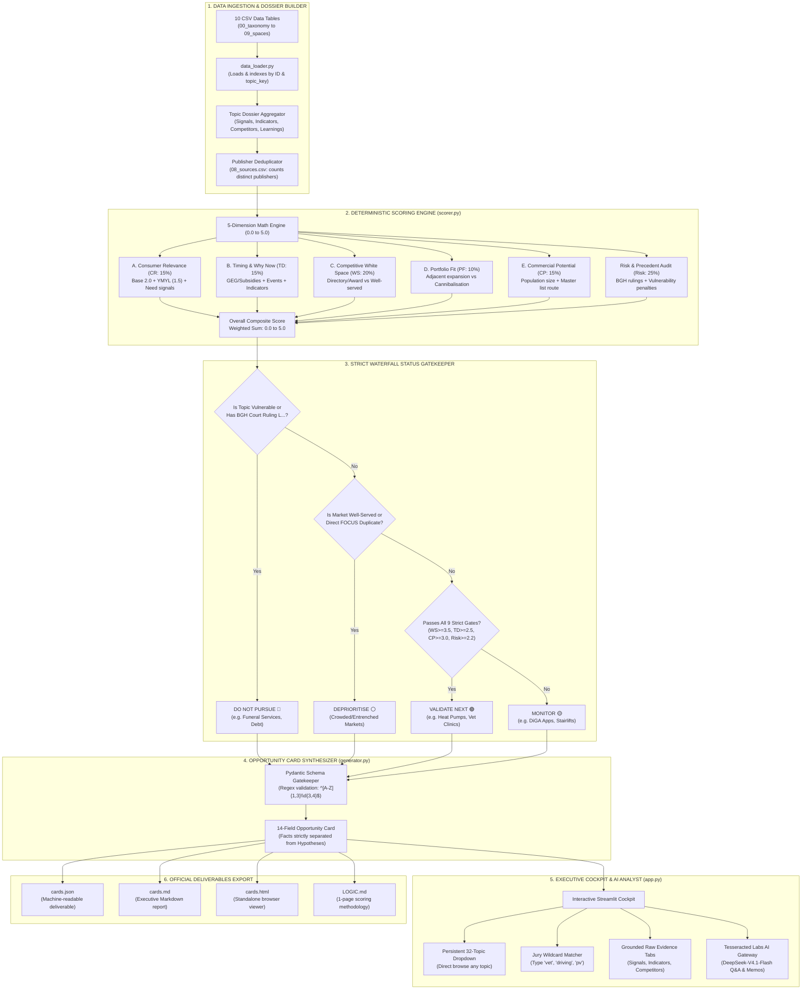

# FACTS Topic Opportunity Scout — Complete System Architecture & Flowchart

**TUM × OMMAX AI Hackathon · Hubert Burda Media / FACTS**

---

## 1. End-to-End System Flowchart (Mermaid Diagram)



---

## 2. Text Architecture Map (Quick Overview)

```
[CSV Datasets (10 Files)]
       │
       ├──► 00_topic_taxonomy.csv (Master 32 Topics, YMYL Status)
       ├──► 01_portfolio.csv      (Current FOCUS Lists & Cannibalisation)
       ├──► 02_learnings.csv      (German Court Precedents & BGH Rulings)
       ├──► 03_signals.csv        (Why-Now Market Signals & Drivers)
       ├──► 04_competitors.csv    (Competitor Rankings & Provider-Pays Proof)
       ├──► 05_market_indicators.csv (Numeric Time-Series Data Points)
       ├──► 06_entity_populations.csv (Entity Sizing & Register Availability)
       ├──► 07_regulatory_events.csv (Dated Laws & Deadlines)
       ├──► 08_sources.csv        (296 Unique Publishers Deduplicated)
       └──► 09_opportunity_spaces.csv (Curated Specific Topics & Hypotheses)
       │
       ▼
[Deterministic Scoring Engine: src/scorer.py]
       ├── Dimension A: Consumer Relevance (15%)
       ├── Dimension B: Timing & Why Now (15%)
       ├── Dimension C: Competitive White Space (20%)
       ├── Dimension D: Portfolio Fit & Brand Alignment (10%)
       ├── Dimension E: Commercial Potential & Entity Pool (15%)
       └── Dimension F: Risk, Precedent & Vulnerability Audit (25%)
       │
       ▼
[Waterfall Status Classifier]
       ├── DO NOT PURSUE   (Red Light: Precedents / Vulnerable Consumers)
       ├── DEPRIORITISE    (Grey Light: Well-Served / Direct Duplicates)
       ├── VALIDATE NEXT   (Green Light: High White Space & Clean Feasibility)
       └── MONITOR         (Yellow Light: Emerging / Waiting for Scale)
       │
       ▼
[Pydantic Guardrail Gatekeeper: src/models.py]
       └── Regex check: Every fact MUST cite a valid ID (^[A-Z]{1,3}\d{3,4}$)
       │
       ▼
[Executive Streamlit Cockpit: app.py]
       ├── 32-Topic Dropdown + Live Jury Matcher
       ├── 14-Field Interactive Opportunity Card Viewer
       ├── Tesseracted Labs Shared AI Gateway (DeepSeek-V4.1-Flash)
       └── Built-In Deliverables Reader (cards.md, cards.json, LOGIC.md, cards.html)
```

---

## 3. The 3-to-5 Curated Deliverable Portfolio

The official deliverables (`cards.md`, `cards.json`, `cards.html`) showcase a balanced portfolio of **5 distinct strategic decisions**:

1. **`heat_pumps`** $\rightarrow$ **VALIDATE NEXT (Score: 3.66)**  
   *TOP Heat-pump installers for owner-occupied homes* (SHK craft businesses, GEG heating law, massive B2B seal licensing potential).
2. **`veterinary`** $\rightarrow$ **VALIDATE NEXT (Score: 3.79)**  
   *TOP Veterinary practices and emergency vet services* (Booming pet health, rising GOT fee schedule, zero court bans).
3. **`home_adaptation`** $\rightarrow$ **MONITOR (Score: 3.73)**  
   *TOP Age-appropriate home adaptation providers* (High demographic need, but fragmented Handwerksrolle master list).
4. **`digital_health`** $\rightarrow$ **MONITOR (Score: 3.51)**  
   *TOP Digital health applications (DiGA) orientation* (High consumer need, but current universe is only 58 approved apps).
5. **`end_of_life`** $\rightarrow$ **DO NOT PURSUE (Score: 3.06)**  
   *TOP Funeral service providers (Bestatter)* (Killed to protect Burda from public backlash and court bans `L015`).
