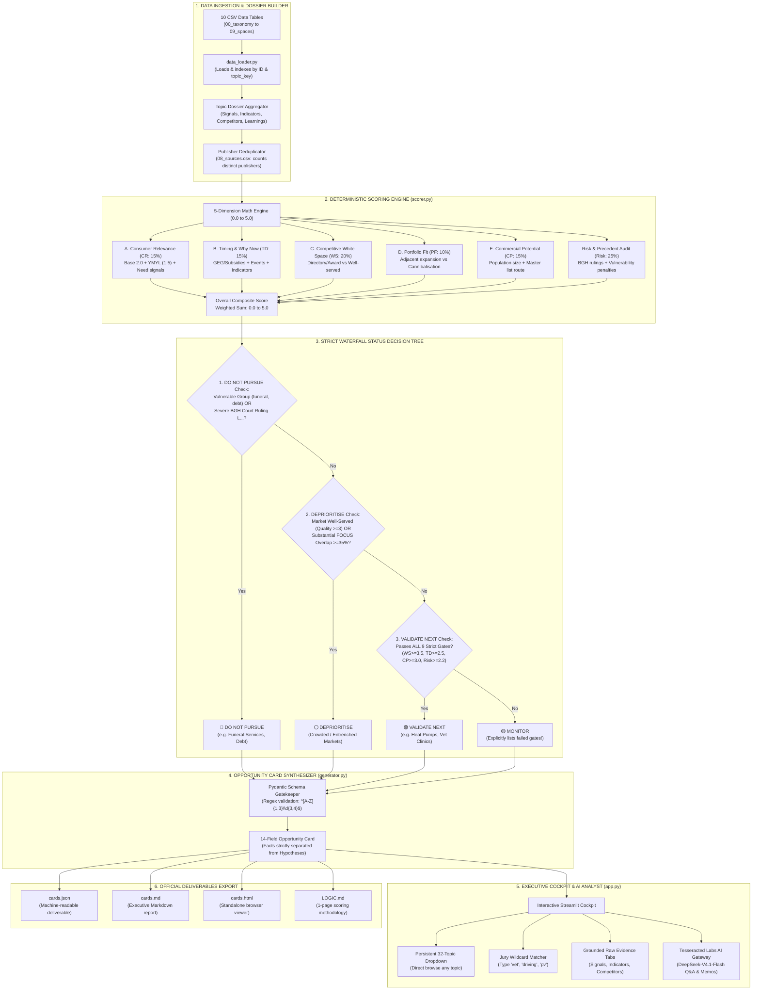

# FACTS Topic Opportunity Scout — Complete System Architecture, Decision Flowchart & AI Copilot Guide

**TUM × OMMAX AI Hackathon · Hubert Burda Media / FACTS**

---

## 1. End-to-End System Workflow (Mermaid Diagram)



---

## 2. The Exact 4-Step Decision Waterfall & The 9 Strict Gates

The status recommendation follows a **strict, non-negotiable waterfall** evaluated in top-down order:

```
┌────────────────────────────────────────────────────────────────────────┐
│                      STEP 1: DO NOT PURSUE CHECK                       │
├────────────────────────────────────────────────────────────────────────┤
│ Triggered IF:                                                          │
│  • Hard stop in config (e.g. M016 24h care labor grey zones & L016/L025)│
│  • Acutely vulnerable group (funeral care, debt counselling, dementia) │
│  • Direct BGH court ruling (L015, L026) with severe legal liability    │
│ ──► ACTION: Assign DO NOT PURSUE 🔴 (Stops evaluation immediately)     │
└───────────────────────────────────┬────────────────────────────────────┘
                                    │ No
                                    ▼
┌────────────────────────────────────────────────────────────────────────┐
│                       STEP 2: DEPRIORITISE CHECK                       │
├────────────────────────────────────────────────────────────────────────┤
│ Triggered IF:                                                          │
│  • Market is "Well served" (>= 3 quality competitors with public test) │
│  • Substantial portfolio cannibalisation (Overlap >= 35% with FOCUS)   │
│ ──► ACTION: Assign DEPRIORITISE ⚪ (Stops evaluation immediately)      │
└───────────────────────────────────┬────────────────────────────────────┘
                                    │ No
                                    ▼
┌────────────────────────────────────────────────────────────────────────┐
│               STEP 3: VALIDATE NEXT (ALL 9 GATES MUST PASS)            │
├────────────────────────────────────────────────────────────────────────┤
│ Gate 1: Overall Composite Score >= 60 (or >= 3.4/5.0)                  │
│ Gate 2: Evidence coverage >= 0.70 across dataset tables                │
│ Gate 3: Consumer Relevance (Dim A) >= 55 / 100                        │
│ Gate 4: Timing & Dynamics (Dim B) >= 50 / 100                          │
│ Gate 5: Competitive White Space (Dim C) >= 50 / 100 (Directory-dom.)   │
│ Gate 6: Risk & Safety (Dim F) >= 50 / 100 (Manageable risk profile)   │
│ Gate 7: >= 2 independent publishers in 08_sources.csv (Golden Rule #3) │
│ Gate 8: Target entity population >= 1,000 entities with master list    │
│ Gate 9: Market landscape is NOT unknown and NOT resting only on future │
│ ──► ACTION: Assign VALIDATE NEXT 🟢 (Green light for feasibility)      │
└───────────────────────────────────┬────────────────────────────────────┘
                                    │ Fails ANY single gate
                                    ▼
┌────────────────────────────────────────────────────────────────────────┐
│                            STEP 4: MONITOR                             │
├────────────────────────────────────────────────────────────────────────┤
│ Assigned to any promising topic that misses at least one gate.         │
│ (e.g. DiGA apps: high consumer need, but only 58 entities in Germany)   │
│ ──► ACTION: Assign MONITOR 🟡 AND EXPLICITLY LIST THE FAILED GATE!     │
└────────────────────────────────────────────────────────────────────────┘
```

---

## 3. How to Use the AI Chatbot / Executive Copilot Part

The dashboard includes a dedicated **Executive AI Analyst Copilot** connected directly to the **Tesseracted Labs Shared Gateway**.

### Where is it in the app?
In your Streamlit dashboard (`http://localhost:8501`), scroll down to the section titled:  
**`🤖 Executive AI Analyst Copilot (Tesseracted Labs Shared Gateway)`**

### What models does it use?
In the left sidebar, the **`🤖 AI Model`** dropdown lets you select:
1. **`deepseek-ai/DeepSeek-V4.1-Flash`** (Default: lightning-fast, analytical, low latency)
2. **`moonshotai/Kimi-K3.1-Pro`** (Long-context reasoning, great for German legal terms)
3. **`zai-org/GLM-5.3-Flash`**

---

### Feature 1: One-Click Executive Investment Memo
- **How to use:** Simply click the button: **`✨ Generate Executive Memo`**.
- **What it does:** The AI reads the current card's dossier and writes a **3-paragraph C-level investment pitch** suitable for Hubert Burda Media’s Executive Board.
- **Guardrail:** The prompt strictly forbids hallucinating numbers and requires the model to cite the exact dataset IDs in brackets (`[R012]`, `[P045]`, `[L028]`).

---

### Feature 2: Live Jury Q&A Copilot (The Interactive Chatbot)
- **How to use:**
  1. Pick or search any topic (e.g. *Heat Pumps*, *Veterinary*, *Funeral*, or *Driving Schools*).
  2. In the text box **`Your Question to the Analyst:`**, type your question.
  3. Click **`Ask Analyst`**.

#### 🎯 Killer Questions to Ask During Your Live Pitch Demo:

| If you are inspecting... | Ask this question to the AI: | What the AI will demonstrate to the judges: |
|---|---|---|
| **Heat Pumps (`heat_pumps`)** | *"What makes this topic an immediate commercial opportunity for FOCUS?"* | Cites the 48,000 SHK firms `[P045]`, the GEG deadline `[R012]`, and explains why lead portals lack transparent quality vetting. |
| **Funeral Services (`end_of_life`)** | *"Why did our system decide DO NOT PURSUE for this topic?"* | Explains the acute vulnerability of bereaved families, the severe risk of pay-to-play media scandals, and court precedent `[L015]`. |
| **Digital Health (`digital_health`)** | *"Why shouldn't we launch a TOP DiGA list right now?"* | Explains that while consumer need is high, the BfArM already runs a free register `[C009]`, and the universe of 58 apps `[P020]` is too small for a B2B seal business. |
| **Veterinary (`veterinary`)** | *"What are the legal risks in veterinary rankings?"* | Confirms that unlike human medicine (`[L015]`), veterinary medicine has zero negative BGH court bans in the dataset, making it a safe green light. |

---

## 4. The 5 Curated Showcase Cards in the Deliverables

| # | Topic Title | Status | Strategic Summary |
|---|---|---|---|
| 1 | **TOP Heat-pump installers for owner-occupied homes** | 🟢 **`VALIDATE NEXT`** | High demand from GEG heating law `[R012]`; 48k SHK businesses `[P045]`; directory-dominated competition. |
| 2 | **TOP Veterinary practices and emergency vet services** | 🟢 **`VALIDATE NEXT`** | High emotional stakes; rising GOT fee reform; zero negative BGH court rulings. |
| 3 | **TOP Age-appropriate home adaptation providers** | 🟡 **`MONITOR`** | High aging demographics (`[I0357]`), but master list across Handwerksrolle is currently fragmented. |
| 4 | **TOP Digital health applications (DiGA) orientation** | 🟡 **`MONITOR`** | Official BfArM public register exists `[C009]`; entity universe is currently only 58 approved apps `[P020]`. |
| 5 | **TOP Funeral service providers (Bestatter)** | 🔴 **`DO NOT PURSUE`** | Grieving consumers in emotional crisis; selling commercial quality seals triggers severe court bans and public backlash. |
